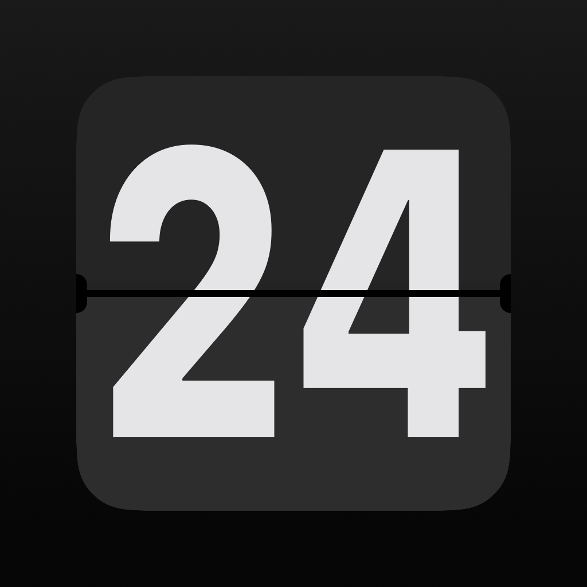
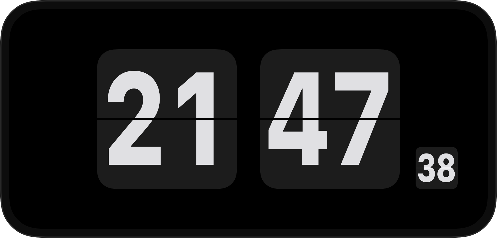
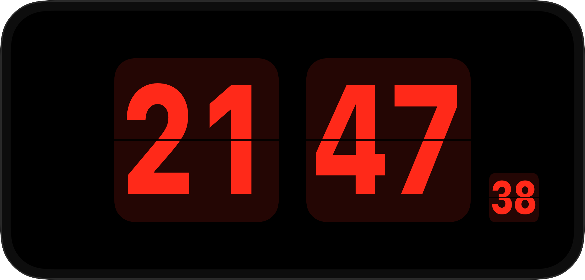

<p align="center">
  
</p>

<h1 align="center">Klappuhr</h1>

<p align="center">from Sarah with Claude 💖</p>

<p align="center">
  A minimalist flip clock for the iPhone's <b>StandBy</b> mode, built with SwiftUI and WidgetKit.<br>
  <i>Klappuhr</i> is German for “flip clock”.
</p>

<p align="center">
  
</p>

<p align="center">
  
</p>

<p align="center"><sub>Rendered previews from the app's own SwiftUI code. Night mode tinting is applied by iOS; the lower image approximates it.</sub></p>

## Features

- **Two StandBy widgets:** one for the hours, one for the minutes. They sit in StandBy's two widget stacks and together form one clock.
- **Live seconds:** a small seconds card next to the minutes, counted by iOS itself every second.
- **Classic look:** black background, dark grey rounded cards, large vertically stretched digits, a thin hinge line through the middle, 24-hour format.
- **Smooth digit changes:** hours and minutes roll over with `contentTransition(.numericText)`.
- **Night mode:** in the dark, StandBy tints the clock red. The widget adapts its brightness levels so it stays readable.
- **Companion app:** a simple screen with a live preview and setup instructions.

## Requirements

- iPhone with iOS 17 or later (StandBy was introduced in iOS 17)
- Mac with Xcode 26 or later
- An Apple account. A free one (Personal Team) works; see [Free accounts](#free-accounts-and-the-7-day-limit).

## Build and install

1. Clone the repository and open `Klappuhr.xcodeproj` in Xcode.
2. Select the project in the navigator. For **both** targets, *Klappuhr* and *KlappuhrWidgetExtension*, open *Signing & Capabilities* and choose your team.
3. The bundle IDs `de.klappuhr.standby` and `de.klappuhr.standby.widget` may already be taken. If so, change both to your own, e.g. `com.yourname.klappuhr` and `com.yourname.klappuhr.widget`. The widget ID must start with the app ID.
4. Connect your iPhone, enable *Developer Mode* (Settings → Privacy & Security), select it as the run destination and press ▶︎.
5. On first install, trust the developer on the iPhone: Settings → General → VPN & Device Management.

## Set up StandBy

1. Settings → StandBy → turn on **StandBy** (and optionally **Night Mode**).
2. Lock the iPhone, lay it on its side and connect it to a charger.
3. Swipe left until you see the view with two widget stacks.
4. Touch and hold the **left** stack → **+** → *Klappuhr* → **Hours**.
5. Touch and hold the **right** stack → **+** → *Klappuhr* → **Minutes**.
6. Remove the other widgets from both stacks so nothing rotates away.

## How it works

| Path | Contents |
|---|---|
| [`Shared/FlipTileView.swift`](Shared/FlipTileView.swift) | The flip card view used by both the app and the widgets, plus the live seconds trick |
| [`KlappuhrWidget/ClockTimeline.swift`](KlappuhrWidget/ClockTimeline.swift) | Timeline provider: one entry per minute (3 h ahead) or per hour (24 h ahead) |
| [`KlappuhrWidget/ClockWidgets.swift`](KlappuhrWidget/ClockWidgets.swift) | The two widgets and their layout towards the centre of the screen |
| [`Klappuhr/ContentView.swift`](Klappuhr/ContentView.swift) | The companion app's info screen |
| [`scripts/`](scripts) | Optional automation for free accounts (see below) |

A few details worth knowing:

- **Widgets don't run continuously.** WidgetKit renders them at the points in time listed in a timeline. The minutes widget gets one entry per minute for the next three hours, which stays well within iOS's reload budget.
- **Seconds in a widget.** Widgets can't redraw every second, but iOS can update a `Text(timerInterval:)` itself. A timer started at the top of the hour displays `MM:SS`, i.e. the current minutes and seconds. The view clips it so that only the last two digits (the seconds) remain visible.
- **StandBy shows only two widgets side by side,** so the seconds card lives inside the minutes widget.
- **Night mode** is detected with `widgetRenderingMode`: in `.vibrant` mode only luminance matters, so the tile becomes a faint translucent white and the digits full white.

## Free accounts and the 7-day limit

Apps signed with a free Apple account stop launching after 7 days. The `scripts/` folder contains an optional helper that keeps the app installed without you having to think about it:

- [`scripts/klappuhr-renew.sh`](scripts/klappuhr-renew.sh) checks how long the installed provisioning profile is still valid. With less than 30 hours left, it removes the old profiles, rebuilds the app with a fresh 7-day profile (`xcodebuild -allowProvisioningUpdates`) and installs it over Wi-Fi (`xcrun devicectl`).
- [`scripts/install-launchd.sh`](scripts/install-launchd.sh) installs a launchd job that runs the script every hour. Runs missed while the Mac sleeps are caught up on wake.
- You get a macOS notification after each renewal and, at most every 6 hours, when something fails.

Setup:

```sh
cp scripts/config.local.example scripts/config.local   # then enter your device ID
xcrun devicectl list devices                           # shows the device ID
scripts/install-launchd.sh                             # install the hourly job
scripts/klappuhr-renew.sh --force                      # optional: renew right now
tail ~/Library/Logs/Klappuhr/renew.log                 # see what happened
```

The Mac has to be on with you logged in, and the iPhone has to be on the same Wi-Fi network. After the iPhone restarts, unlock it once so Xcode can reach it again.

To remove the job:

```sh
launchctl bootout gui/$(id -u)/de.klappuhr.renew
rm ~/Library/LaunchAgents/de.klappuhr.renew.plist
```
